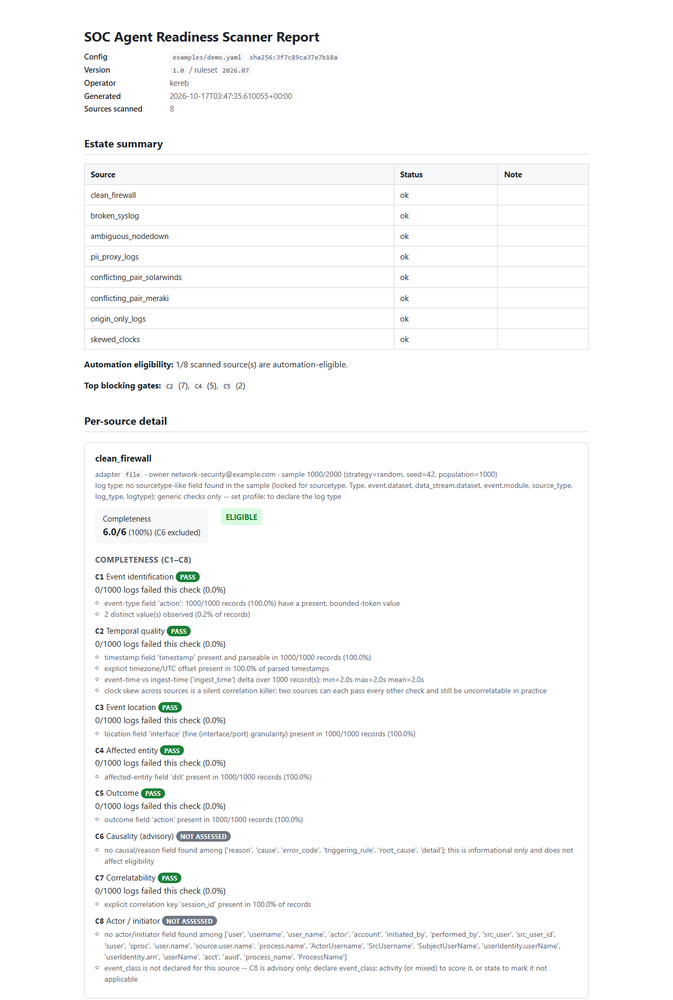

# SOC Agent Readiness Scanner

Before a security or IT operations team lets a log source drive an
automated decision — an auto-remediation, an auto-suppression, a
compliance finding — someone has to answer: *does this data actually
carry enough information to act on safely?* Today that judgment is
tribal knowledge. This tool answers it repeatably, against a bounded,
read-only sample of each source, and produces a report with concrete
evidence behind every finding.

It scores every source against eight completeness checks (C1–C8; C6 is
advisory-only, and C8 is scored only when a source declares its
`event_class` — see below) and derives automation eligibility from a
small, explicit set of gates — never a threshold on the overall score.

**Works directly against Splunk, Microsoft Sentinel, and
Elastic/OpenSearch — or a local file export for a quick, offline
check.** Point it at the Security Information and Event Management
(SIEM) system you already run and it samples live data over a
read-only connection; point it at an export and it runs with no
network access at all. Same checks, same report, either way.

## What this tool does not do

- It does not fix data quality problems, or modify/delete anything at
  any source. Every adapter is read-only by construction — there is no
  write method on the adapter interface to call in the first place.
- It does not do threat detection, alerting, or judge whether any given
  alert is a true positive. It only asks whether the *data* is fit to
  drive automation, not what the automation should do.
- It does not analyze full datasets. Every source is sampled, with a
  hard ceiling on records fetched, and the sampling strategy and seed
  are always recorded in the output.
- It does not stream or run in real time — batch sampling only.

See [SECURITY.md](SECURITY.md) for the full list of security
commitments and [§ roadmap](#roadmap--explicitly-deferred) for what's
intentionally not built yet.

## Disclaimer

This tool reports a judgment over a bounded sample of data — not a
guarantee, a certification, or a substitute for a qualified person's
review. An ELIGIBLE verdict means the sampled records cleared a
defined set of checks; it does not mean the source is error-free, that
the report is 100% accurate, that automation against it is safe in
every circumstance, or that the tool has seen every record that source
will ever produce.

Decisions to automate — or not automate — against any source are yours
alone. This project is provided "AS IS," without warranty of any kind,
and the authors accept no liability for outcomes arising from its use
or from decisions made based on its output. See [LICENSE](LICENSE) for
the full legal terms.

## Quickstart

No config needed for a first look — point it at a file:

```bash
pip install -e .
scanner quickscan ./your-export.jsonl
```

That's the full report, with defaults for everything else. If the file
is a Splunk JSON export, add `--record-root result` (the report will
tell you if you needed it). When it's worth keeping, let it write the
config for you:

```bash
scanner quickscan ./your-export.jsonl --record-root result --emit-config scanner.yaml
scanner scan --config scanner.yaml --format markdown
```

The emitted config holds only what you chose — set each source's
`owner:`, then grow it from there ([CONFIG.md](CONFIG.md)).

**Scanning a live SIEM source** works the same way, just with a
connection block instead of a file path — same checks, same report, no
export step:

```yaml
# scanner.yaml
version: "1.0"
ruleset_version: "1"
splunk:
  host: "splunk.example.com"
  token_env_var: SPLUNK_TOKEN   # read from the environment, never from this file
sources:
  - name: firewall
    adapter: splunk
    query: 'index=network sourcetype=pan:traffic'
    owner: "network-security@example.com"
```

```bash
export SPLUNK_TOKEN=...
scanner scan --config scanner.yaml --format markdown
```

`adapter: sentinel` and `adapter: elastic` work the same way, with
their own connection block. Every remote adapter checks the account's
capabilities before it runs a single search and refuses outright if it
finds anything write-capable — see [CONFIG.md](CONFIG.md) for the
connection details and [SECURITY.md](SECURITY.md) for the read-only and
credential-handling guarantees.

Copy-paste starter configs for each — every field commented, placeholder
values instead of examples that look real — are in
[`examples/`](examples/): [`splunk.yaml`](examples/splunk.yaml),
[`sentinel.yaml`](examples/sentinel.yaml),
[`elastic.yaml`](examples/elastic.yaml). Copy one, fill in the
placeholders, set the credential environment variable it names, and
`validate-config` before the first real scan.

To see every check fire without touching a real system, scan the
bundled demo instead:

```bash
scanner scan --config examples/demo.yaml --format markdown
```

This runs entirely offline against the synthetic sample data bundled in
`./samples/` — no network calls, no credentials, nothing outside this
repo. `--format json` (the default for `scan`) or `--format html` work
the same way. Try `scanner validate-config --config examples/demo.yaml`
first if you just want to check the config parses.

## Example output



*The HTML report for the bundled demo config -- estate summary, automation eligibility, and full C1-C8 detail per source.*

This is the `origin_only_logs` sample — a source that is well attributed
to its reporting device but never records who or what the event actually
happened to:

```
**Score:** 1.5/6 (25%) (C8 not assessed) (C6 excluded)

**Automation eligibility:** NOT ELIGIBLE
- C4 (affected entity identifiable): C4 is FAIL: no affected-entity
  identifier found: none of ['target', 'dst'] are present in the sample
  -- owner: network-ops@example.com

**Completeness (C1-C8)**

- C4 -- Affected entity: FAIL
  - no affected-entity identifier found: none of ['target', 'dst'] are
    present in the sample
  - Records are well attributed to their reporting device but the
    affected entity cannot be reliably identified (C4 FAIL). Automated
    action requires knowing what to act on, not only what reported it.
```

A remediation agent that only knows *what reported* an event, not *what
it happened to*, has nothing to act on — that's exactly the class of gap
this check exists to catch, and it catches it even when origin
attribution is flawless.

## The checks

**Completeness (C1–C8)** — does each record carry enough information to
be useful? (C6 excluded from scoring — advisory only)

| # | Name | What it checks |
| --- | --- | --- |
| C1 | Event identification | Is there a stable, enum-like event-type field? |
| C2 | Temporal quality | Timestamp present/parseable, explicit timezone, event-time vs. ingest-time distinguishable, clock skew across origins. |
| C3 | Event location | Is there an interface/host/site-level location field, ranked by granularity (finer beats coarser)? |
| C4 | Affected entity | Who/what did the event happen to — deliberately independent of origin resolution's "who reported it." The flagship completeness check. |
| C5 | Outcome | Is there a result/status/disposition field? |
| C6 | Causality *(advisory, not scored)* | Is there a reason/cause field? Can never FAIL or block eligibility — only PASS or NOT_ASSESSED. |
| C7 | Correlatability | Is there an explicit correlation key, or a composite key constructible from timestamp + an identifiable entity field? |
| C8 | Actor / initiator *(scored only when `event_class` is declared)* | Who *performed* the action — the third entity alongside "who reported it" (origin) and "who it happened to" (C4). |

A few checks carry design decisions worth knowing about beyond the table above:

- **C4 (affected entity)** is deliberately never a variant of origin
  resolution. Origin resolution asks who generated the record; C4 asks
  who it happened to. These are different entities, frequently confused,
  and conflating them is exactly the mistake that makes an automated
  remediation act on the wrong host.
- **C6 (causality)** is advisory only and can never fail a source or
  block eligibility — most telemetry records symptoms, not causes, and
  failing sources for lacking a causal field would fail nearly
  everything and train operators to ignore the report.
- **C8 (actor/initiator)** completes the entity triad: *reporter ≠
  actor ≠ target*. For identity-touching automations (disable an
  account, kill a process) the actor is often the decision-critical
  field — but a state event ("node down", "disk failed") has no actor
  by definition, and no amount of sampling can distinguish "incomplete
  log" from "inapplicable concept." So applicability is declared, never
  inferred: set `event_class: activity` (scored), `state` (not
  applicable), or `mixed` (scored, FAIL softened to WARN) per source.
  Undeclared sources get an advisory-only C8 that reports what it found
  without scoring — nothing false-fails out of the box. C8 never gates
  eligibility; the gate set stays frozen at C2/C4/C5.
- Every check evidences its findings with concrete counts, percentages,
  or examples. "Attribution could be improved" is not acceptable output
  from this tool; "67% of records carry no affected-entity field
  (6,712 of 10,000 sampled)" is the bar.

## Automation eligibility

Eligibility is **not** a threshold on the overall score. It's an
explicit, named list of gates: C2 PASS, C4 PASS, C5 PASS-or-WARN. A
source can score 5/6 (83%) overall and still be correctly ineligible if
the one miss is a gated check — `skewed_clocks` in the bundled demo
scores 5.0/6 but is ineligible on C2 alone, proving this is possible,
not just permitted.

## Agent-readiness recommendations

The checks say what is missing. The report's Recommendations section
says what to do about it: for every FAIL or WARN, **what field to add**,
**the decision it enables** for an automation, and — the part that
makes it actionable — **where the fix realistically lives**, since
engineers usually can't change a vendor's log format:

```
- [FAIL] origin_only_logs / C4 (Affected entity) -- owner: network-ops@example.com
  -- no affected-entity identifier found: none of ['target', 'dst'] are present
  - Add: dst / target / TargetUserName -- a field naming what the event happened
    to, distinct from the device that reported it
  - Enables: the agent knows what to act on, not only what reported it
  - Where: device/application logging configuration (vendor side); ingest-time
    enrichment or normalization (SIEM pipeline, Cribl, lookup)
```

C2 reads its own evidence and recommends only what that source needs —
an explicit UTC offset, an ingest-time field, or clock synchronization
rather than any new field at all.

Each source also gets one **ADVISORY** line if it lacks the context
fields an agent needs to act *safely*: a `maintenance_window` flag (so
it doesn't "remediate" a host that is intentionally down), an
`environment` tag (prod vs. dev), and `asset_criticality`. These are
never scored — they aren't completeness deficiencies, and they almost
never come from the device. They come from a CMDB or the change
calendar, via enrichment.

Recommendations are additive. They never feed scores or gates, so they
can't turn into requirements by the back door.

## Continuous use: drift detection and CI gates

A single scan answers "is this source fit to automate against today?"
The question that keeps a scanner installed is "did anything change?"
— a firmware update that silently dropped the timezone from every
timestamp, a logging-profile edit that removed the target field. Every
`scan` writes a journal entry with each source's eligibility, score,
and per-check statuses, and that journal is the baseline:

```bash
# On a schedule: fail the job if anything got worse than last time
scanner scan --config scanner.yaml --fail-on regression

# As an onboarding gate: fail if any source isn't automation-eligible
scanner scan --config scanner.yaml --fail-on ineligible

# What changed between the last two runs (add --exit-code for pipelines)
scanner diff --config scanner.yaml
```

"Worse" is ranked, not just different: PASS → WARN, PASS → FAIL,
WARN → FAIL, and an assessed check becoming NOT_ASSESSED (the timestamp
field vanished, so C2 couldn't run) are regressions; FAIL ↔ NOT_ASSESSED
is a lateral move and never trips a gate. Eligibility flipping to NOT
ELIGIBLE is a regression that names the newly failing gates.

Exit codes are distinct so a pipeline can tell a broken job from a real
finding:

| Code | Meaning |
| --- | --- |
| 0 | Scan completed; no requested policy failed. |
| 1 | The scan itself did not complete (bad config, adapter error, a source that errored). |
| 2 | The scan completed and the data failed a `--fail-on` policy. |

The baseline is the previous journal entry with the same `--config`
path string, so run scheduled scans from the same directory with the
same path to keep one continuous history per config.

## Feeding results back into a SIEM

A report is for a person reading it once. `--format jsonl` is for a
dashboard: one self-contained JSON event per line, so a scheduled scan
can be piped straight into whatever the audience already watches
instead of producing a document that goes stale the moment it's read.

```bash
scanner scan --config scanner.yaml --format jsonl --journal "" \
  | curl -s https://<splunk-host>:8088/services/collector/raw \
      -H "Authorization: Splunk <hec-token>" --data-binary @-
```

Every line carries `event_type` so one index holds all of them and a
query filters on it — `scan` (one per run), `source_summary` (one per
source: score, eligibility, failed gates, sample), `check_result` (one
per check per completed source — this is what a completeness-over-time
chart is built from), `conflict`, and `recommendation`. Every line also
carries `time` (so the SIEM's own time-based indexing needs no extra
configuration) and `run_id`, so every line from one invocation can be
grouped back together after ingestion — `stats by run_id` in Splunk, or
`summarize by RunId` in a KQL table, ties a run's events into one view.

## Log-type profiles

The generic checks judge every source against one set of expectations.
Usually you know what a source *is* — `pan:traffic`,
`WinEventLog:Security`, `SigninLogs` — and that changes what "complete"
means. A **profile** describes a known log type: which fields play
which role, what kind of events it records, which fields a correctly
configured source always carries, and what to do when they're missing.
The scanner auto-detects the profile from the data's `sourcetype`
(Splunk), `Type` (Sentinel), or `event.dataset` (Elastic), or you name
it with `profile:` on the source.

With a profile, a finding stops being "no outcome field found" and
becomes:

```
- [ADVISORY] firewall / PROFILE (Expected fields for Palo Alto Networks
  firewall traffic log) -- 3/9 field(s) this log type normally carries
  are below their expected presence: action (0% vs >= 99%), rule (0% vs
  >= 95%), app (0% vs >= 90%)
  - Guidance: Check each security policy rule's "Log at Session End"
    setting and the log forwarding profile attached to it. In Splunk,
    confirm the Palo Alto Networks Add-on is installed -- without its
    field extractions most of these fields never exist.
```

Profiles are strictly additive: role hints go *first* in the candidate
lists but the generic ones still follow, a profile's `event_class`
applies only if the source didn't declare one, and conformance is
advisory — the C1–C8 verdicts are exactly what they'd be without it. A
source that mixes several log types gets told so, with the split. Nine
profiles ship (`scanner profiles` lists them); writing your own is one
YAML file — see [PROFILES.md](PROFILES.md).

## Standards mapping

Most logging standards require the same record content in different
words — what happened, when, where, to what, by whom, with what outcome.
[STANDARDS.md](STANDARDS.md) maps each check to the requirement it
evidences in NIST SP 800-53 (AU-3, AU-8), PCI DSS v4.0 (Req. 10.2.2),
OMB M-21-31, and NIST SP 800-92, and to the MITRE ATT&CK data components
a source's fields make usable — plus an explicit list of what the tool
does *not* cover (retention, integrity, review, coverage), so a report
is filed as evidence for the right things and nothing else.

## Configuration

See [CONFIG.md](CONFIG.md) for the full reference. `scanner
validate-config --config <path>` checks a config without running a scan.

## Limitations

- File inputs are read as JSON-per-line (nested objects flattened to
  dotted keys, with `record_root` to unwrap enveloped exports such as
  Splunk's), logfmt `key=value` lines, or CSV/TSV with a header row.
  There is no RFC3164/5424 syslog header parser yet — plain syslog lands
  in the raw-text fallback and will score as unstructured. Point the
  scanner at the SIEM (Splunk/Sentinel/Elastic adapters) for such
  sources instead, where the fields are already extracted.
- Sampling is bounded and, for `random`/`stratified` strategies against
  Splunk or Sentinel, an oversample-then-locally-sample approximation —
  not a query against the full matching result set, since neither has a
  version-independent server-side seeded sampling primitive to rely on.
  See each adapter's own docstring for the exact tradeoff. Elastic is
  the exception: its `random_score` query is itself seedable
  server-side, so its `random` strategy requests exactly the configured
  sample size directly, no oversampling needed.
- C2's cross-origin clock-skew detection is a statistical heuristic
  (per-origin median timestamp vs. the sample's pooled median). With
  few records per origin, sampling noise itself can look like skew;
  with enough records per origin it converges on genuine skew. It is
  not a substitute for NTP monitoring.
- The missing-precedence-rule conflict detection can only see overlap
  that shows up in the *sampled* records from both sources — it can
  miss real overlap that didn't happen to appear in either sample,
  though it never fabricates an overlap that isn't in the data.

## Roadmap / explicitly deferred

Not built in this version:

- LLM-assisted finding summarization (would be optional and off by
  default even if added, since it breaks air-gap capability)
- Streaming/real-time analysis (batch sampling only, by design)
- Auto-remediation of data quality issues (this tool diagnoses, it does
  not fix — see "What this tool does not do" above)
- A web UI

The Sentinel and Elastic/OpenSearch adapters are built the same way
the Splunk one is, for the same reason: each depends only on a narrow
connection protocol, with a real implementation that lazily imports
its client library as an optional extra
(`pip install -e ".[sentinel]"` / `".[elastic]"`), so every adapter's
test suite runs against a fake connection with no live server required
— nothing here is tested only by hand against a real SIEM. See
[CONFIG.md](CONFIG.md) for the `sentinel:`/`elastic:` connection blocks.
